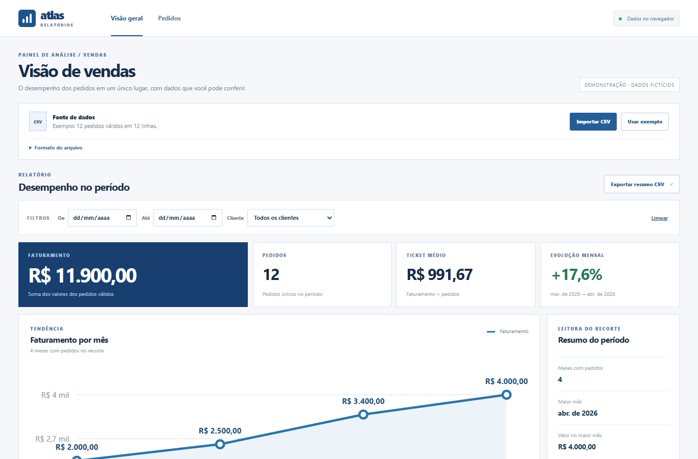

# CSV Sales Report

A static, browser-only page that imports a sales CSV, validates each row, rejects inconsistent records with a reason, and shows totals that can be checked against the rows that produced them.

> **Demonstration project with fictitious data.** All orders, customers and amounts in this repository are invented. This is a personal lab project: it has not been deployed for a client, used with real data, or measured in production. The user interface is in Brazilian Portuguese.



## Problem

A small team exports orders to CSV and needs gross revenue, order count and average order value for a period. The data is in the file, but an inconsistent format or a duplicated row can quietly distort the summary. The goal was a simple view whose totals can always be traced back to the source records.

## What it does

- **Import:** reads a CSV chosen by the user, entirely in the browser. Nothing is uploaded or stored.
  - Required columns: `pedido_id` (order ID), `data` (date), `valor` (amount). `cliente` (customer) is optional.
  - Accepts comma or semicolon separators, quoted cells, and UTF-8 with or without BOM.
  - Dates: `YYYY-MM-DD` or `DD/MM/YYYY`, checked against the calendar (for example, 31/02 is rejected).
  - Amounts: non-negative BRL values such as `1234,56`, `1234.56` or `1.234,56`.
- **Validation:** rejects duplicate IDs, impossible dates, invalid or negative amounts, and rows with the wrong number of columns, listing the reason for each rejected row. A missing header or malformed CSV raises an error without replacing the data already loaded.
- **Indicators**, all following the active date and customer filters:
  - gross revenue (summed in integer cents);
  - order count;
  - average order value;
  - change between the last two months that have orders;
  - monthly chart;
  - table of the underlying orders.
- **Export:** downloads a CSV summary with one row per month plus a total row, for the active filter.

## Technologies

- Plain JavaScript, HTML and CSS, with no framework, build step or third-party runtime dependency.
- Node.js only to run the tests and the optional local server, using built-in modules (`node:assert`, `node:http`, `node:fs`).

## Project structure

| File | Purpose |
|---|---|
| `index.html` | Page markup |
| `atlas.css` | Styles, including the mobile layout |
| `metrics.js` | CSV parsing, validation, filtering and aggregation. Has no DOM access and is shared by the page and the tests |
| `app.js` | UI: file import, filters, chart, table, export |
| `test-metrics.js` | Automated tests for `metrics.js` |
| `serve.cjs` | Minimal static server bound to `127.0.0.1` |
| `exemplo-pedidos.csv` | Fictitious sample: 12 valid orders totalling R$ 11,900.00 |
| `exemplo-com-erros.csv` | Fictitious sample with 1 valid row and 3 invalid ones (duplicate ID, impossible date, negative amount) |

## Running

Open `index.html` directly in a browser, or serve the folder locally (requires Node.js, tested with v24):

```sh
node serve.cjs
```

Then open `http://127.0.0.1:8767`. The fictitious sample, embedded in `app.js`, loads automatically. Use **Importar CSV** to load another file, such as `exemplo-com-erros.csv`, to see the rejected rows.

## Tests

```sh
node test-metrics.js
```

The test suite checks:
- the known totals of the sample file (12 orders, R$ 11,900.00);
- the monthly series and the month-over-month change;
- date and customer filters;
- average order value;
- edge cases (no data, previous month with zero revenue);
- money and date parsing;
- rejection of the invalid sample rows;
- errors for a missing column and for unbalanced quotes.

The page was also checked in Chrome (headless) at desktop width and at a simulated 390 px mobile width. The check covered import of both samples, filters, indicators and the CSV export download. No physical device or other browser was tested.

## Limitations

- **One row per order.** The meaning of "amount" is whatever the CSV provides. Taxes, fees, discounts, returns and cancellations are not handled; prepare the file with the orders that should count.
- No integration with ERPs or marketplaces, no scheduled updates, no persistence, no authentication, no multi-user access.
- Fixed column names in Portuguese (`pedido_id`, `data`, `valor`, `cliente`) and BRL amounts.
- The orders table shows up to 100 rows of the current selection.
- Using it with real data would require an authorized sample, agreed business rules and independent validation of the totals.

## License

[MIT](LICENSE)
